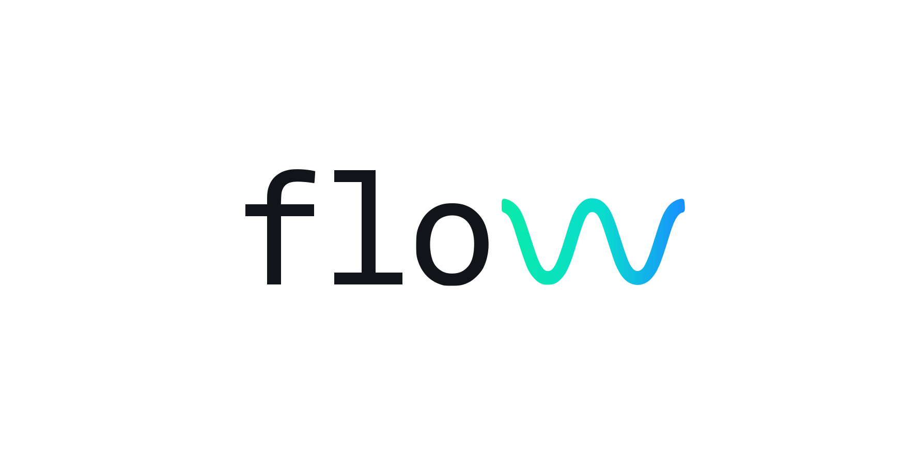
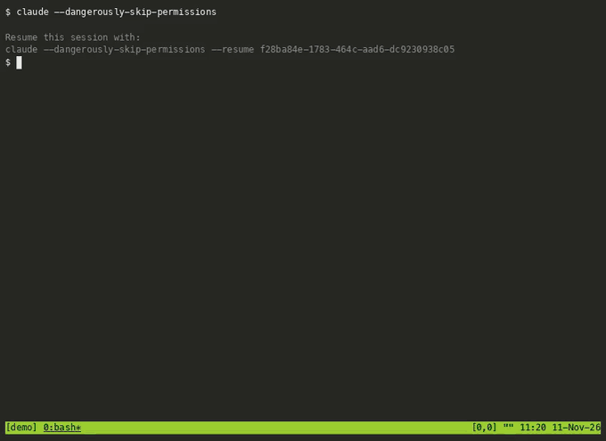
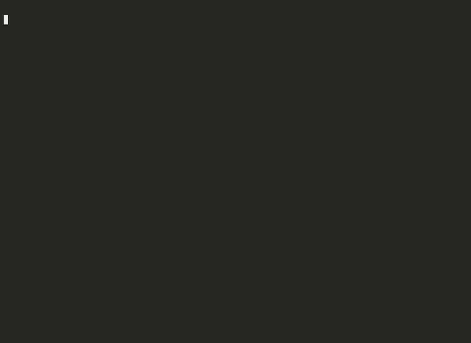

<p align="center">
  
</p>

<p align="center">
  <a href="https://facets-cloud.github.io/flow/"><strong>Website</strong></a> ·
  <a href="#try-it-in-ten-minutes">Install</a> ·
  <a href="#watch-one-happen">Demo</a> ·
  <a href="CHANGELOG.md">Changelog</a>
</p>

<p align="center">
  
  
</p>

You run Claude Code or Codex. You say "let's pick up the billing migration"
and the session for that work opens where it stopped, with its notes read.
You say "pick up issue 59, I'm going to sleep, find me on Slack if you need a
decision" and go to sleep. flow is the small local CLI underneath that makes
those sentences work: each piece of work gets a name, a session, a brief,
dated notes and a mailbox. SQLite and markdown in `~/.flow`. You talk to the
agent; the agent runs flow.

If you run three or more agent sessions a day and lose track of them, keep
reading. If one session at a time works for you, you do not need this.

## If you do not care how it works

Skip everything below and try it for a week. It makes the AI you already use
better and more predictable: your work gets names, your sessions stop
forgetting, and you ask one place what happened instead of rereading ten
chats. The first two days are irritating, because it asks you to name
things and interviews you about them. Around day three it becomes the thing
you would not give back. If that is not true for you after a week, delete
`~/.flow` and nothing is left behind.

## Watch one happen



One take, unedited except for speed. Recorded 11 November 2026 on a clean
flow root, with a real open issue on this repo.

```
 the sentence   "pick up issue-59, skip permissions. I'm going to sleep. if you need
                 a decision, find me on Slack."
 25 minutes     the task reads the issue, reproduces it, writes 8 failing tests, fixes,
 (shown at 10x) runs the suite. Nobody told it how. The brief was eight lines.
 the question   on its own it asks, over Slack: "fixed + tested on a local branch,
                 nothing pushed. Push and open a PR?  Push + open PR | Hold"
 the reply      typed in Slack: "push and open PR". It reaches the task in seconds.
 the morning    "what happened with issue 59 while I was asleep?" answered from the
                 task's note, including two things it could not verify.
 the result     PR #135 (https://github.com/Facets-cloud/flow/pull/135), CI green,
                 waiting for a human review. Nothing merged by an agent.
```

Two honest notes on that take. The task could have split the work into
headless children and chose not to; it judged the fix small. And the Slack
reply was typed at the top level, not in the thread, which the connector did
not expect; it does now.

<details>
<summary><b>Second take: one window as the driver, five children, a Friday launch (2 min)</b></summary>



A fictional Go service with four things left before a Friday launch. One
sentence binds the session as the driver. On its own it splits the work into
four headless children, asks five questions in one batch with defaults if you
stay silent, verifies each child's branch before trusting it, spawns a fifth
child for bugs it found on the way, stops a slow child when told to and parks
the real fix in the backlog, dry-merges all six branches in a scratch worktree,
and closes the task with a note. Nothing pushed. Real time 11 minutes; the
working stretches run at 30x.

</details>

## Written from the user's chair

Rohit Raveendran started flow in April 2026 at Facets. He and I (Anshul Sao)
maintain it now, with contributors. I am its heaviest user, so this README is
the user's account, not the maker's: the numbers come from my laptop, the
messages are real, and the rough edges are ones I hit.

The problem, in the words people use for it: you run several sessions and
keep losing track of them. One sits idle for an hour on a "Should I proceed?"
you cannot see. Another compacts and asks what you want to work on, so you
re-explain the task and pay again for the same discovery. Background work says
"running" until a human notices it died. Overnight runs come back
half-finished, and the only record is a transcript nobody reads.

`claude --resume` gets one conversation back. It does not give the work a
name, tell the session where its notes are, let it hand work to another
session, tell you which one needs you, or reach you when you are not looking.
That is the part flow adds.

## Three levels, in the sentences you say

```
level 1   names and notes                    nothing runs unattended, nothing is skipped
  "add a task for the billing migration"     a brief, a folder, a session with a name
  "let's pick up the billing migration"      the session opens where it stopped, notes read
  "note that the token expiry is 900s"       a dated note the next session will read
  "what happened on billing while I was out" answered from the notes, not your memory
  "what's on my plate"                       every task, which is waiting on whom

level 2   playbooks                          a brief that reruns, and gets better
  "make this a nightly playbook"             each run is a task with its own session and note
  a run that learns something proposes an edit to the brief; you approve; the
  next run starts smarter. Mine today: a daily cloud-cost diff, a Slack channel
  watch, a nightly production release with a before and after health check,
  a daily post draft. The post draft has been rewritten five times in a week.
  The channel watch has run 138 times and never needed a change.

level 3   children and the bus               sessions that work for your session
  "drive this end to end, use children"      one task you talk to runs several you do not
  "I'm asleep, find me on Slack"             the task asks when it must; you answer from
                                             Slack, a dialog, or any session
  "spawn a child to re-test risk 2"          when you want to decide the split yourself
  children run with permissions skipped. Brief them with gates.
```

Most people install for level 1. Level 3 is where my days now happen.

## A Tuesday, in five lines

Real messages from my logs, 10 November, names changed. Everything I typed is
a sentence to Claude Code.

```
10:18  me: "drive this end to end. use children."
       by 10:22 five children are reading, each with a brief the driver wrote

16:34  child -> driver  "gateway wedged, all calls timing out. My parallel scans
                         likely saturated it. Stopped them, backing off."
       driver -> others "Hold ALL gateway calls until I message you."

16:41  child -> driver  "done: PR #133, trust work_dir before launch, tests green"
       a flow bug I had hit at 11:04, fixed while the day's work kept running

20:14  dialog on my Mac: "OK for the regression check to send 1 real sign-in
                          link per run? Reply with the recipient address."
22:07  me:               "go ahead"
```

What came out of the day: a proposal corrected by mid-afternoon because a
child found the kickoff assumption was wrong, one flow PR merged, one
regression check shipped that night, five analysis notes on disk.

## Your first month, honestly

```
day 1    "add a task for the thing I'm mid-way on". Close the tab. That is all.
day 2    "let's pick up <that thing>". It opens where you left it, notes read.
         This is where it clicks or does not.
week 1   a second task, a third. "what happened on X" becomes a question you
         ask the task, not your memory. First playbook if you have a chore.
week 3   "drive this, use children". One task you talk to runs three you do
         not. You start writing briefs instead of prompts.
month 1  something runs while you sleep and asks you one question in the
         morning, with its notes attached. Or it does not, and you are still
         happy at level 1.
```

## Three things a chat alone cannot do

From my logs this month, names changed. I cannot link private logs; where a
public pull request documents the behaviour, it is linked.

**Two siblings settled a schema in one minute, with nobody watching.**

```
worker-a -> worker-b  "I'll add FixNote{Change,Note,By,At} as Finding.FixNotes,
                       bson 'fix_notes', array, $push. Please use the same so
                       the UI reads it. OK?"
worker-b -> worker-a  "OK. I'll define the identical struct in my branch too,
                       same text so the rebase is trivial."
worker-a -> worker-b  "FYI: detector/judge/sweeper ReplaceOne whole docs and
                       would wipe fix_notes. I'm switching to $set; you only
                       need $push."
```

**A one-line steer reached a running child in five minutes.**

```
me:              "dont sequencilize work merging deployment u can"
driver -> child  "CHANGE (from the human: don't sequence): release main NOW,
                  don't wait for #10. Keep polling main and release again
                  whenever it moves. Report each release."
```

Four releases followed in the next hour. Driver tasks exist because I typed
"status" about sixty times on an earlier 42-child task
([#117](https://github.com/Facets-cloud/flow/pull/117)).

**An owner called a production incident correctly.**

For 52 days this summer an owner swept one production service roughly hourly:
460 graded sweeps, 161 issues and PRs filed, 71 fix tasks of which 51 closed.
How many of the 161 were noise I cannot tell you from the record. On 30 July
its sweep read: "MongoDB lost quorum at 14:49:42Z and writes were blocked for
6m34s. For the first time in this ledger's history the replica set fell to 1
of 3 with no PRIMARY." It was right. I paused it on 31 July and never wrote
down why.

## The questions you are already asking

**Isn't this just `claude --resume`?** For level 1, mostly, plus a name, a
brief, notes the next session reads, and a record that outlives the
transcript. Levels 2 and 3 are the part resume does not have.

**Isn't this just subagents?** Subagents live inside one chat and die with it.
flow tasks outlive the chat, have names, and talk to each other.

**Isn't this a memory product?** No. Memory tools write facts behind your back
and you cannot see what loaded. flow keeps work: a brief you wrote, notes you
can read, a transcript you can open. When a session says it knows where you
left off, you can see the note it read.

**Isn't this Jira for agents?** No. Nothing here is for a team. It is one
person's laptop. Some people stretch it across a team and the issues show it.
It is not built for that, and I will not pretend it is.

**Do I have to learn a CLI?** No. The agent runs it. The commands exist for
scripts and for the curious; I use two of them a month.

**Will it nag me?** Once. When your 25th task closes, flow drops one FYI in
your inbox asking for a GitHub star, then never again; `FLOW_QUIET=1` turns
even that off.

**Why should I believe you?** You should not. Read the next two sections.

## Works with, does not work with

```
works with      Claude Code and Codex as the session harness. Terminals: iTerm,
                Terminal.app, Warp, kitty, Ghostty, zellij, tmux. No terminal:
                headless, resume by name.
Codex           parity shipped in alpha.35. Honesty: all 479 of my tasks in the
                last fortnight ran on Claude. The Codex path is tested by
                contributors, not by my daily use.
a colleague     an opt-in peer link lets your flow message a colleague's flow
                and their human. Mail between two laptops, not a shared board.
does not        Jira, Linear, GitHub Issues: no integration, none planned.
                Teams: no shared state. Windows: no.
scheduling      not in flow today. My playbooks fire from launchd plists I
                copied by hand. flow schedule (launchd, systemd, cron) is in
                review ([#130](https://github.com/Facets-cloud/flow/pull/130)).
reaching you    connectors are small scripts: a macOS dialog ships with flow, the
                Slack one in the video is 60 lines of bash and will ship as a
                sample. Without one, asks wait in your inbox until you look.
```

## What breaks, what it costs

As of 11 November 2026, on the current alpha.

- **Absence looks like silence.** Mail to a session that already exited sits
  pending forever and never bounces. A "dead" notice can be wrong: two children
  marked dead last week finished fine. A scheduled run that fails to start
  writes one log line and nothing else. My nightly release job failed to start
  for 53 nights in a row before anyone noticed. The flag that caused it is gone;
  the gap that let it hide is not.
- **3% of headless runs die.** 12 of 381 this fortnight. The harness killed a
  child's own monitors; a cloud login expired mid-run; two were me. In June it
  was 22%. There is no retry. The research child that helped write this README
  died twice: once waiting on background subagents, once on a network error
  overnight.
- **Unattended means re-authenticating.** 111 of my headless logs carry the
  harness warning that the sign-in can end at any time.
- **Owners do not stop themselves.** One owner spent 289 wakes confirming a DNS
  switch that was already confirmed on wake one, because its charter said keep
  going and I never answered its question about cadence. Only a human stops an
  owner, and this human mostly clicked Skip.
- **Before alpha.32, agents ate the human's mail.** I had answered 0 of 28
  messages sent to me, because agent sessions popped them first
  ([#118](https://github.com/Facets-cloud/flow/pull/118)). Fixed.
- **There is no stop verb.** "Stop all children" meant kill by pid.
- **No search.** Project, tag, task tree, or grep `~/.flow`.
- **Transcripts get pruned** by the harness after some weeks, not by flow. The
  notes survive. Nine of my eighteen September sessions are gone; their notes
  are not.
- **Tokens.** Every session loads the 54 KB skill (about 13k tokens) plus a
  4 KB hook at start. A child is a full session. A Slack check that makes one
  API call costs a 60 KB transcript. In July users measured flow at about a
  fifth of their weekly Claude usage; the skill was halved then. I have not
  measured a per-day dollar figure and will not invent one.
- **The newest parts are two weeks old.** Children, the bus, dialogs and peer
  hubs shipped in six alphas over nine days. 97% of all the mail my flow has
  ever carried is from this fortnight. The core (names, sessions, notes) has
  seven months behind it.
- **macOS and Linux.** Linux merged this week
  ([#127](https://github.com/Facets-cloud/flow/pull/127)); the first Linux
  build is pending, and until it is cut the Linux install command 404s.
  No Windows.

## Try it in ten minutes

```
curl -fsSL https://raw.githubusercontent.com/Facets-cloud/flow/main/install.sh | sh
flow init
```

Or open [INSTALL.md](INSTALL.md) in Claude Code or Codex and let the agent
install it. `flow init` installs a skill and a session-start hook into your
harness. That is how the agent knows what "pick up the billing migration"
means. Those two commands are the last ones you need to type.

1. In Claude Code, mid-way on something: "bind this session to a task called
   <name>". The conversation you already have is now a task. Starting fresh:
   "add a task for <thing>". You get interviewed; it is annoying once.
2. Close the tab. Tomorrow: "let's pick up <name>". A tab opens where you
   left off (or it runs headless if you have no supported terminal).
3. Children, playbooks and the bus make sense after three or four tasks. Not
   before.

Upgrade with the same install command. Uninstall by deleting the binary and
`~/.flow`.

## Numbers, for the record

```
last 15 days, current alpha   479 tasks      287 children     126 playbook runs
                              381 headless   12 died          1,005 messages

seven months                  2,210 tasks    one session resumed over four months
                              one driver that ran 42 children in two days
                              one owner that filed 161 issues and PRs in 52 days

the repo                      114 commits    34 alpha releases   18 people have landed PRs
```

One person, one laptop. An existence proof, not a benchmark.

## Do not install this if

- One session at a time works for you.
- You want a shared board for a team.
- You are on Windows.
- You never want an agent running with permissions skipped on your machine.
  Level 1 never does; level 3 always does.

## Reference, for the curious

You will not type these. The agent does. They are here so the words on
this page match the binary, and because three tests in the repo insist.

### Human connectors

When a task needs your decision and you are away, it asks on the bus and
moves on. Without a connector the ask waits in your inbox. With one, flow
pings you through it; a macOS dialog ships built in, and the Slack one in
the video is a sample.

```bash
flow message user "deploy-v2: ship to prod now?" --options "Yes|No"
flow message user "imports 3/5 done" --fyi        # progress: stored, never pings
flow connector add macos                          # built in, shows a test dialog
flow connector list --available                   # built-in samples
flow connector priority flowhub 1                 # tried first
flow connector priority macos 2                   # fallback tier
flow connector escalate 10m                       # unseen 10m after delivery, next tier
```

The contract to write your own is in
[`internal/app/skill/references/connectors.md`](internal/app/skill/references/connectors.md).
Each connector gets its own secret, so an agent can never answer for you.

### Peer hubs

Two flow homes can message each other through a connector with the peer
role. It is mail between two laptops, not a shared board.

```bash
flow connector add peer-local                     # testing-only sample, same machine
flow peer add bob --via peer-local --at /path/to/bobs/flow-root
flow message bob "ship v2?" --options "Yes|No"    # from a task session, to bob's human
```

Details, including how a hub hands inbound mail to a task:
[`internal/app/skill/references/peers.md`](internal/app/skill/references/peers.md).

## Status

Alpha. Daily use since April; the data model has not broken under me since
May; the CLI surface still moves. If you try it and bounce, open an issue and
say at which step. We read them.

MIT.
