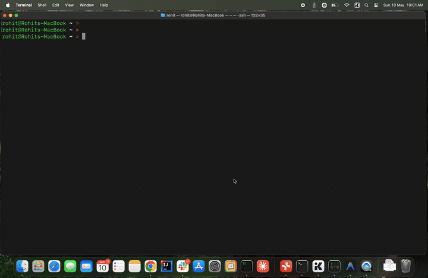
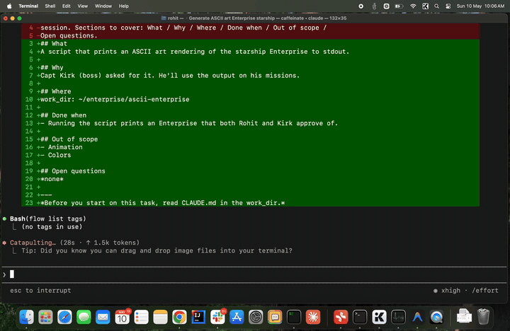
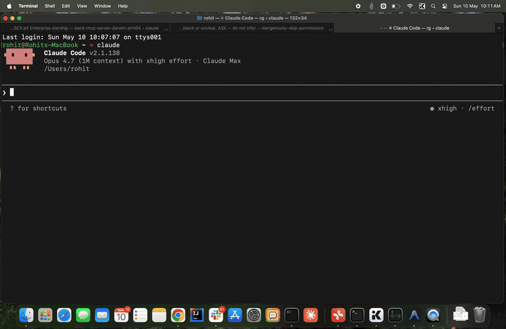

<p align="center">
  
</p>

<p align="center">
  <a href="https://facets-cloud.github.io/flow/"><strong>Website</strong></a> ·
  <a href="#install">Install</a> ·
  <a href="#see-it-in-action">Demo</a> ·
  <a href="#how-flow-compares">Compare</a> ·
  <a href="CHANGELOG.md">Changelog</a>
</p>

<p align="center">
  
  
</p>

**Coding agents are brilliant but forgetful. You end up being the memory and
the manager for your own AI.**

flow is a task manager for Claude Code and Codex. Every task gets its own
agent that remembers the plan, the decisions and what you learned along the
way, so you never re-explain your work. You can pick a task back up by name
days later, or hand it off to run on its own.

<!-- TODO(launch): replace with a ~20s hero cut of Act 4 (the new session already knows everything). -->
<p align="center">
  
</p>

One person, 7 months: 2,100+ tasks, 1,800+ agent sessions, 1,000+ background
runs, 700 facts learned.

## Install

macOS, with Claude Code or Codex. In any Claude Code or Codex session, paste:

> Install flow from https://github.com/Facets-cloud/flow

Your agent downloads the binary and runs `flow init`. Or do it yourself:

```bash
ARCH=arm64        # Apple Silicon. Use amd64 for Intel Macs.
curl -fsSL -o /usr/local/bin/flow \
  "https://github.com/Facets-cloud/flow/releases/latest/download/flow-darwin-${ARCH}"
chmod +x /usr/local/bin/flow
xattr -d com.apple.quarantine /usr/local/bin/flow 2>/dev/null || true   # unsigned binary, see docs/setup.md
flow init         # required: creates ~/.flow and installs the skill + hooks for your agents
```

<!-- TODO(launch): these are not live yet. A sibling task is building the tap and install.sh.
     Swap them in above the manual steps once they work. -->
Coming soon, not working yet:

```bash
brew install facets-cloud/tap/flow                                              # TODO
curl -fsSL https://raw.githubusercontent.com/Facets-cloud/flow/main/install.sh | sh   # TODO
```

Then open Claude Code or Codex and say **"let's get to work"**. flow asks what
you are working on and takes it from there. [What `flow init` sets up](docs/setup.md).

## How it works

You talk to your agent as usual. The flow skill turns what you say into tasks,
notes and sessions. You never need to learn the commands.

```
   capture ---> work ---> park ---> resume by name ---> done
      |            \                                    |
      |             '--> or run it in the background    |
      v                                                 v
   task brief  <------ every session loads ------  what flow learned
```

1. **The task is the unit, not the chat.** Each task has a short plan (what,
   why, where, done when), dated progress notes, and its own agent
   conversation. `flow do <task>` opens it in a new terminal tab; next week the
   same command puts you back in the same conversation.
2. **Closing a task teaches the next one.** When you close a task, flow reads
   the whole conversation and saves the durable facts (your team, your
   customers, how you do things) into plain markdown files that every future
   session loads. Session fifty knows what session one learned.
3. **Same task, with or without you.** Any task can run in the background to
   completion, repeat on a schedule, or be looked after by an agent that
   checks in on its own.

Without flow, every session is a new hire: capable, but with no memory of
yesterday's decisions or the half-finished work in your other tabs. With
flow, it's the engineer who was there last week.

It isn't only for code. People use it for customer migrations, ops work,
follow-ups and writing too.

## Runs without you

Most of the time you'll work with a task in a tab. When you don't need to be
there:

- **Background runs.** Start any task with nobody watching. It works to its
  "done when", writes a note, and closes itself.
- **Routines.** Write a brief once (a morning triage, a weekly review) and run
  it as often as you like. Each run is its own task.
- **Handing work off.** In a long conversation, side questions become
  background tasks while you keep talking. Results come back as notes.
- **Owners.** An agent that keeps something true over weeks ("staging stays
  healthy", "tell me when the customer replies"). It wakes on a schedule,
  reads its own notes, does what's needed, and goes back to sleep. Nothing
  runs in between.
- **Agents message you.** When a background agent needs a decision it asks
  in your inbox, or pops a macOS dialog, and your answer goes back to the
  task that asked.

Details and commands: [docs/running-without-you.md](docs/running-without-you.md).
Pings through a dialog or other channels: [docs/connectors.md](docs/connectors.md).

## How flow compares

|  | **flow** | Claude Code native (CLAUDE.md, auto memory) | claude-mem | Taskmaster | Vibe Kanban¹ |
|---|---|---|---|---|---|
| Unit of work | Task: plan, notes, its own conversation | Session | Session | Task list generated from a PRD | Kanban issue with a workspace |
| Plan and progress notes per task | ✅ | ❌ | ❌ | ✅ | ✅ |
| Memory across sessions | ✅ plain markdown, written when you close a task | ✅ CLAUDE.md + auto memory | ✅ automatic capture | ❌ | ❌ |
| Resume a conversation by name | ✅ `flow do <task>` | ✅ `claude --resume <name>` | n/a | n/a | per workspace |
| Runs in the background | ✅ background runs, routines, owners | ✅ `--bg`, scheduled tasks | n/a | n/a | ✅ agents in workspaces |
| Agents can ask you a question | ✅ inbox, macOS dialog | ✅ Agent View | ❌ | ❌ | ✅ in the app |
| Non-code work | ✅ | ✅ | ✅ | ❌ | ❌ |
| Claude Code and Codex | ✅ both | Claude only | ✅ 15+ agents | ✅ via MCP | ✅ 10+ agents |
| GUI and diff review | ❌ terminal only | partial | ❌ | ❌ | ✅ |
| Worktree isolation for parallel agents | ❌ | ✅ `--worktree` | ❌ | ❌ | ✅ |
| Linux and Windows | ❌ macOS first | ✅ | ✅ | ✅ | ✅ |
| License | MIT | proprietary | Apache 2.0 | MIT + Commons Clause | Apache 2.0 |

¹ Vibe Kanban's README says it is sunsetting (checked November 2026).

flow works alongside Claude Code's own features rather than replacing them.
Claude Code tells you what is running now; flow keeps track of the work over
weeks, across both Claude Code and Codex. If you mainly want to review diffs
from several agents working on one repo in parallel, a GUI tool will suit you
better.

## See it in action

A four-act demo of how flow carries context across days and tasks. The work
is silly on purpose (Star Trek starships) so you watch the mechanics, not the
code.

**Act 1: Capture the work.** You just talk. flow asks what, why, where and
done-when, writes the brief, and opens a dedicated session for the task in a
new tab.



**Act 2: Work, then park.** The session starts with the brief, the project
and what flow already knows. You build until you hit a blocker ("Kirk needs
to review this") and tell the agent to park it. The tab can close.



**Act 3: Resume and close.** A day later you say "Kirk signed off." The same
session resumes where it left off. Closing the task makes flow re-read the
conversation and save what it learned: Kirk approved the design, the ship
class, the conventions used.



**Act 4: Months later, a new captain.** New task: "Picard's the new boss, he
wants the starship as an SVG." A brand new session, but it already knows the
ship, the design Kirk approved, and the project conventions. It just gets to
work.


## What you get

- **Plain-English control.** "What should I work on", "resume auth", "save a
  note", "I'm waiting on Priya". The skill turns it into flow commands.
- **One task, one agent, one tab.** Works in iTerm2, Warp, Terminal.app,
  Ghostty, kitty, zellij and Rex. [Terminals and session details](docs/terminals.md).
- **A knowledge base that grows.** Five markdown files: you, your org, your
  products, your processes, your customers.
- **Progress notes** you can read later, and that the agent reads on resume.
- **Background runs, routines and owners.** [Running without you](docs/running-without-you.md).
- **Your data stays local.** Plain markdown and a SQLite index under
  `~/.flow/`. No server, no cloud, no telemetry. [Layout, backup and stats](docs/your-data.md).

## Upgrade

In any Claude Code or Codex session:

> Upgrade flow from https://github.com/Facets-cloud/flow

Your agent downloads the latest release binary the same way as the manual
install above (`releases/latest/download/flow-darwin-${ARCH}`, then `xattr -d
com.apple.quarantine`), and runs `flow skill update` to refresh the skill and
hooks for every agent that has them. Check the version with `flow --version`.

## Where flow runs

macOS today, with Claude Code and Codex. The zellij and kitty backends don't
use macOS APIs, so they work on Linux if you build from source. Session
spawning is one small package per terminal, and Linux (tmux, wezterm),
Windows Terminal and other agents need contributors who use them daily.
[A PR is very welcome](CONTRIBUTING.md).

## Where flow came from

flow started as an internal tool at Facets. We use coding agents every day,
and losing context between sessions was limiting how much of them we could
actually use. flow fixed that for us, so we're open-sourcing it as it is.

It is not a Facets product. There's no signup, no cloud, no upsell.

## Docs and contributing

- [Running without you](docs/running-without-you.md): background runs, routines, owners, messages
- [Human connectors](docs/connectors.md): get pinged when an agent needs you
- [Terminals and sessions](docs/terminals.md)
- [What `flow init` sets up](docs/setup.md)
- [Your data](docs/your-data.md): layout, backup, `flow stats`
- [Contributing](CONTRIBUTING.md) · [Changelog](CHANGELOG.md) · [Security](SECURITY.md) · [Code of Conduct](CODE_OF_CONDUCT.md)

## License

[MIT](LICENSE), © 2026 Facets Cloud
